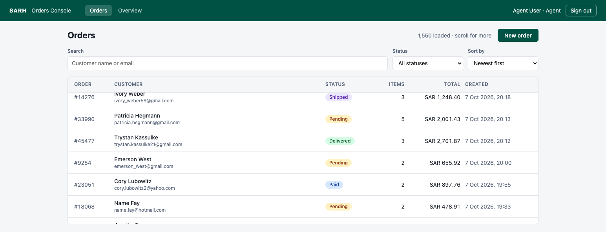
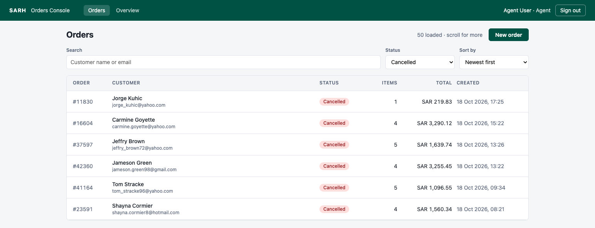
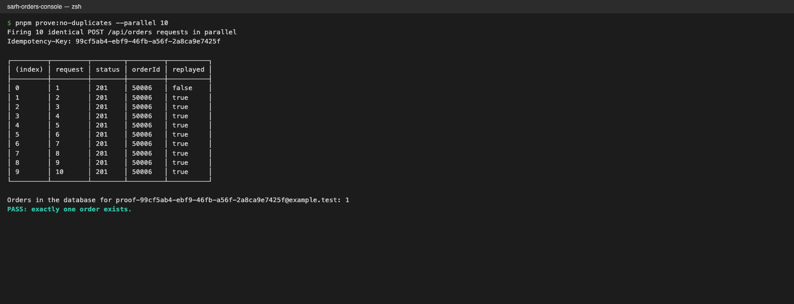
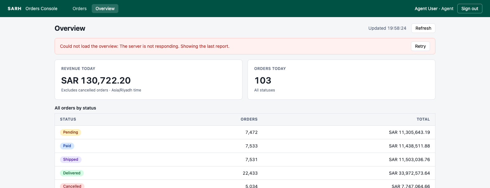

# Orders Console

A small operations console for SARH's take-home brief: agents search a list of 50,000+ orders and
register phone orders by hand, and an order can never be created twice.

- **R1** – a list that stays fast at 50k rows and never shows stale results.
- **R2** – order creation that is safe against double-clicks, retries and resends.
- **Code review** – the contractor's `auth.ts`, fixed and used to protect `/api/orders`.
- **O1** – the deliberately slow stats endpoint, behind an Overview tab.

Design decisions and AI use are in [DECISIONS.md](DECISIONS.md); the 5M-orders memo is in
[SCALE.md](SCALE.md).

**Stack:** React 19 + Vite + TanStack Query/Virtual · Express 5 · PostgreSQL + Drizzle · Zod schemas
shared by both sides · Vitest. A pnpm monorepo: `apps/api`, `apps/web`, `packages/shared`.

## Setup

Needs Node 22.12+ (`.nvmrc`), pnpm (developed with 12) and PostgreSQL 14+.

```bash
nvm use
cp apps/api/.env.example apps/api/.env
createdb sarh_orders          # or: docker compose up -d, then use the Docker URLs in .env
pnpm install
pnpm db:setup                 # migrations + seed: 50,000 orders, ~150k line items, 2 users (~7s)
pnpm dev                      # API on :3001, web on http://localhost:5173
```

| User  | Email             | Password     |
| ----- | ----------------- | ------------ |
| Admin | `admin@sarh.test` | `Admin#2026` |
| Agent | `agent@sarh.test` | `Agent#2026` |

Only the admin can delete orders. `pnpm db:seed` resets the data at any time (same customers, items
and amounts every run; dates span the year before today); `pnpm db:seed --orders 1000000` seeds a
larger set.

## Tests and checks

```bash
pnpm test                     # 66 API tests + 36 web tests
pnpm prove:no-duplicates      # R2 proof against the running API (pnpm dev); add --parallel 50
pnpm typecheck && pnpm lint && pnpm format:check
```

The API tests run against a real Postgres database, `TEST_DATABASE_URL`, which they create if
missing and wipe on every run; they refuse to start if it equals `DATABASE_URL`. Web tests use jsdom
with a stubbed `fetch`. If the web tests fail to start with
`Cannot read properties of undefined (reading 'bind')`, the shell is on an older Node: run `nvm use`.

## R1 · A large list that stays fast and correct

- **Keyset (cursor) pagination.** Each page asks for rows strictly after `(sort value, id)` of the
  last row, so Postgres seeks into an index instead of skipping rows. Pages are 50 rows; one extra
  row is fetched to know whether another page exists, so there is no `COUNT(*)`.
- **Virtualised infinite scroll.** Only the visible rows are in the DOM (27 with 1,550 loaded).
- **No stale results.** Each filter combination has its own cache entry and the screen only reads
  the current one, so a late response lands where nobody is looking. The superseded request is also
  aborted (`AbortSignal` passed to `fetch`). Search is debounced by 300 ms.

Indexes (`apps/api/src/db/schema.ts`), each matching one query shape:

| Index                                                   | Serves                                  |
| ------------------------------------------------------- | --------------------------------------- |
| `(created_at, id)`, `(total_cents, id)`                 | Sort by date or amount, both directions |
| `(status, created_at, id)`, `(status, total_cents, id)` | Status filter + either sort             |
| GIN trigram on `customer_name`, `customer_email`        | `ILIKE '%term%'` search (`pg_trgm`)     |

Measured with `EXPLAIN ANALYZE` on 1,000,000 orders: first page 0.01 ms, a page from the middle of
the table 0.1 ms (the same page with `OFFSET` takes 162 ms), status filter + amount sort 0.02 ms,
search for a surname 17 ms.

## R2 · Create order, no duplicates

The client generates one `Idempotency-Key` per intended order and resends it on every retry. The
server claims the key and writes the order in the same transaction; the key's primary key makes the
claim exclusive, so a concurrent duplicate waits and then gets the original order back. The full
reasoning and its limits are in [DECISIONS.md](DECISIONS.md#1-r2-idempotency-key-claimed-in-the-same-transaction-as-the-order).

## Code review: the contractor's `auth.ts`

| #   | Problem                                                                                                               | What I changed                                                                                                                   |
| --- | --------------------------------------------------------------------------------------------------------------------- | -------------------------------------------------------------------------------------------------------------------------------- |
| 1   | `jwt.decode` does not check the signature: anyone can write themselves an admin token.                                | `jwt.verify` pinned to `HS256`, with `issuer` and `audience`.                                                                    |
| 2   | The secret is hard-coded in source (`"sarh-secret-2026"`), so every copy of the repo can sign tokens.                 | `JWT_SECRET` from the environment, at least 32 characters; the API refuses to start in production with the `.env.example` value. |
| 3   | Tokens never expire.                                                                                                  | 8-hour expiry: one shift.                                                                                                        |
| 4   | Tokens are accepted from `?token=`, which leaks them into server logs, browser history and `Referer` headers.         | The token is read from an httpOnly cookie only.                                                                                  |
| 5   | `authorization?.split(" ")[1]` accepts any scheme, or none.                                                           | Removed with the header itself.                                                                                                  |
| 6   | The role is trusted from the token, so a demoted admin stays admin until the token expires.                           | The token carries only the user id; the user and role are loaded from the database on every request.                             |
| 7   | Delete is "admin-only" only in the React `AdminOnly` component; any agent can call the API directly.                  | `requireRole("admin")` on the server; agents get 403. Hiding the button in the UI is now just convenience.                       |
| 8   | Passwords are stored and compared as plain text, inside the query.                                                    | scrypt hashes with a per-user salt, compared with `timingSafeEqual`.                                                             |
| 9   | `req.body.password` can be an object (`{"not": ""}`); with Prisma that matches any password, so it is a login bypass. | The login body is validated with Zod: both fields must be strings, otherwise 400.                                                |
| 10  | No limit on login attempts: passwords can be brute-forced.                                                            | 10 failed attempts per 15 minutes per IP address (`express-rate-limit`); successful logins do not count.                         |
| 11  | An unknown email answers faster than a wrong password, so response time reveals which emails exist.                   | Unknown emails are checked against a dummy hash; both cases return the same 401 and message.                                     |
| 12  | The delete route does not validate `id` and answers `ok: true` even when nothing was deleted.                         | `id` is validated (400), a missing order is 404, success is 204.                                                                 |

Each fix has a test in `apps/api/test/auth.test.ts` or, for password hashing,
`apps/api/test/password.test.ts`, including tokens signed with the old secret,
`alg: none`, expired tokens, and a valid token sent the old ways. Restoring `jwt.decode` and removing
`requireRole` made five of them fail.

**Where the token is stored.** In an httpOnly, `SameSite=Strict` cookie scoped to `/api` (and
`Secure` in production), never in JavaScript-readable storage. That stops an XSS bug from stealing
the token and stops other sites from sending requests with it (CSRF). It does not stop injected
script from making requests as the user while the page is open, and logging out clears the cookie
but does not revoke a copied token before it expires.

## O1 · The slow stats API

`GET /api/orders/stats` returns totals per status plus today's orders and revenue (cancelled orders
excluded, "today" in `Asia/Riyadh`), after a random 3–6 s delay. The Overview tab never blocks:
it shows an elapsed-seconds counter and the rest of the console stays usable. Leaving the tab aborts
the request, and the server stops waiting and skips the queries when the client disconnects. A
failure shows an error with one Retry button and no silent automatic retries; a failed refresh keeps
the last report on screen. Requests give up after 15 s.

## Evidence

**R1 · 1,550 orders loaded by scrolling, 27 rows in the DOM.**



**R1 · Rapid-filter test.** The status filter was changed Paid → Shipped → Cancelled in quick
succession. To make the race real, the Paid and Shipped responses were delayed in the browser by 1.5 s
and 1 s, so they would arrive after Cancelled. Request log captured during the run:

```text
+5ms     status=paid       sent
+10ms    status=paid       aborted by the client
+10ms    status=shipped    sent
+13ms    status=shipped    aborted by the client
+13ms    status=cancelled  sent
+26ms    status=cancelled  response 200 arrived
```

The table shows only cancelled orders. The same race is tested deterministically in
`apps/web/src/features/orders/use-orders-list.test.tsx`.



**R2 · Ten identical create requests in parallel: one order.**



**O1 · A failed refresh: an error with one Retry, the last report still visible.**



## Product question: "Delete all cancelled orders"

1. What problem does it solve: a cluttered list, storage, or something else? Refunds, chargebacks,
   VAT audits and fraud checks often still need cancelled orders.
2. All of them, or only those older than some age? Who may press it, and must it be undoable?
3. If she cannot answer: hide cancelled orders from the default view behind a toggle. It fixes the
   clutter today and loses nothing; bulk deletion waits until we know what must be kept.

## What I skipped and why

- **O2 (optimistic create).** The brief allows one option. Showing an order before the server
  confirms it works against R2, and an optimistic row has no correct place in a server-sorted,
  filtered, paginated list. See [DECISIONS.md](DECISIONS.md).
- **Session revocation and refresh tokens.** Logout clears the cookie, but a copied token stays valid
  for up to 8 hours. Deleting a user ends their sessions at once, because every request loads the
  user from the database; a `session_version` column would add "sign out everywhere" cheaply.
- **A better login limiter.** It counts in memory, per process, and per IP address. That is enough
  for one server, but an office of agents behind one IP shares a single budget of 10 failures.
  [SCALE.md](SCALE.md) covers the fix.
- **Expiring idempotency keys.** Keys are kept forever. Production needs a cleanup job with a window
  far longer than any retry (days, not seconds).
- **Total result count.** "50 loaded · scroll for more" instead of "1–50 of 4,812". An exact count
  costs a scan on every filter change (153 ms for one status at 1M rows) for little value to agents.
- **Order detail, editing and status changes.** Not in the brief.
- **End-to-end browser tests.** Behaviour is covered by API tests against Postgres and component
  tests; I checked the real flows by hand in the browser instead of adding Playwright.
- **Arabic / right-to-left UI.** The agents probably need it. It belongs with a design pass, and it
  is not part of this exercise.
- **Deployment, HTTPS and a production build pipeline.** Out of scope; the cookie is already `Secure`
  when `NODE_ENV=production`.
- **Commits made as I went.** I built this in phases over two days (setup, R1, R2, auth, O1, docs)
  but committed only at the end. The history follows those phases, with each file in its final form
  in the phase that introduced it, so the intermediate commits do not all build on their own.
